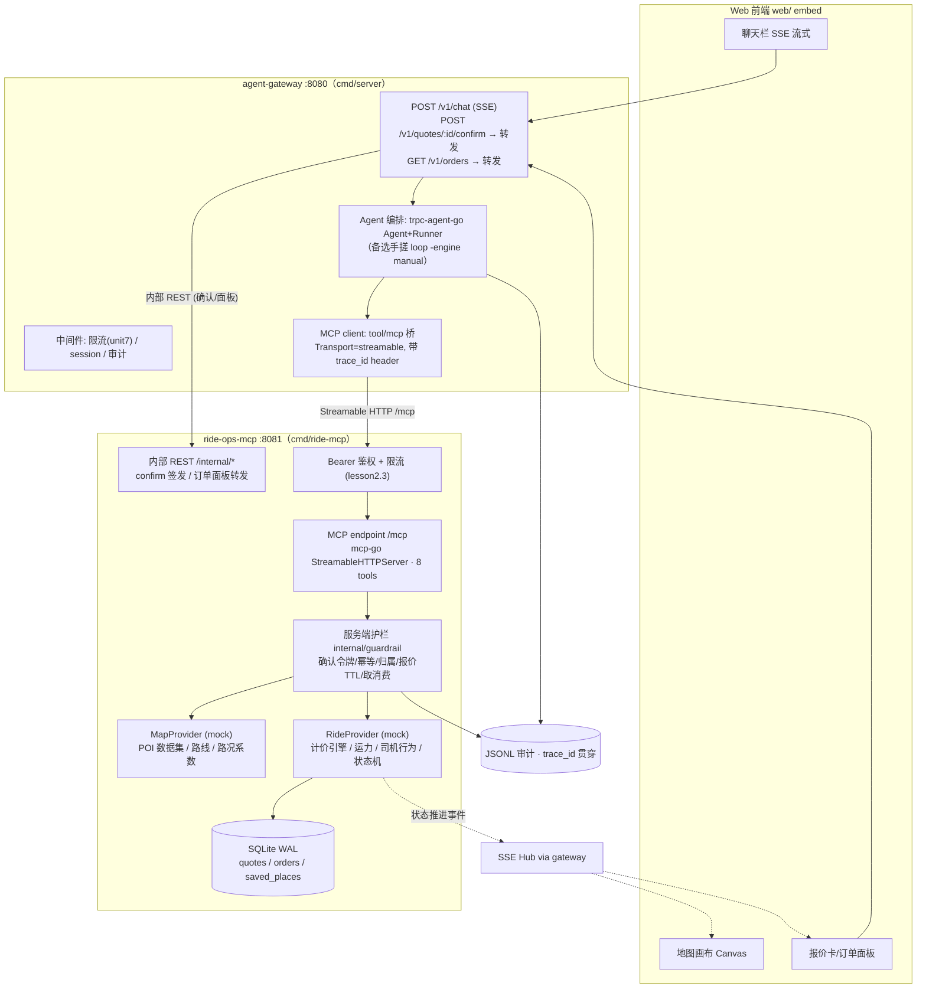
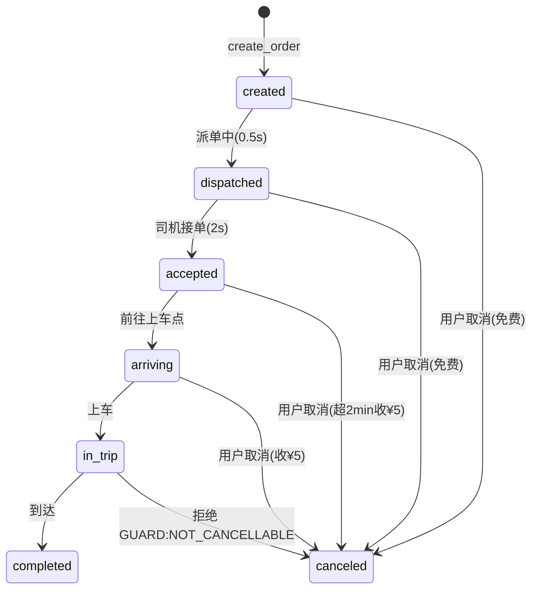

# lesson6.1 — 打车领域 Agent 应用（技术方案）

面向 **阳光出行 / 滴滴 AI 应用开发工程师** 岗位的练习项目：一个跑在打车场景里的
对话式 Agent，覆盖 **地图搜索 → 行程规划 → 价格估算 → 下单确认与下单 → 查询订单 →
取消订单** 的完整闭环，带 Web 界面、服务端护栏、可离线评估。

> 状态：**M1+M2+M3 已实现并联调通过**——双进程可跑，CLI/浏览器全链路（搜→规划→估价→确认→下单→查询→取消）验证通过，
> 三道闸护栏（NEED_CONFIRM / FOREIGN_ORDER / QUOTE_EXPIRED / NOT_CANCELLABLE / 取消费）用例全过，
> 前端（Vue3 + Element Plus X）构建产物已 go:embed 进 gateway 单二进制。
> 无 `DEEPSEEK_API_KEY` 时默认 offline 脚本引擎可跑；配置 key 后自动切换 DeepSeek 主链路。M4/M5 待做。

## 〇、快速开始

```bash
# 1. 构建前端（已有产物可跳过；改前端后需重跑并重新编译 Go）
cd web && npm install && npm run build && cd ..
cp -R web/dist internal/gateway/dist

# 2. 一键起双进程（ride-mcp :8081 + gateway :8080）
./scripts/dev.sh
# 或分两个终端：
#   go run ./cmd/ride-mcp        # 能力服务（MCP + SQLite + 状态机）
#   go run ./cmd/server          # gateway（SSE + Web，无 key 走 offline 引擎）

# 3. 打开 http://127.0.0.1:8080  浏览器全链路演示
#    或 CLI：go run ./cmd/cli
#    输入「从望京SOHO去首都机场T3」→ 报价卡确认 → 查询/取消订单

# LLM 主链路（可选）：
DEEPSEEK_API_KEY=sk-xxx ./scripts/dev.sh
```
> 依赖已验证：`mark3labs/mcp-go v0.37.0` 提供 `NewStreamableHTTPServer`，
> `trpc-agent-go v1.11.2` 的 `tool/mcp` 桥原生支持 `Transport: "streamable"`。

## 一、为什么练这个（对齐 JD）

| JD 常见要求 | 本项目落点 |
| --- | --- |
| LLM 应用开发、Prompt 工程 | 多轮出行对话的 system prompt、槽位补全（缺起终点追问）、拒答与改口 |
| Agent / Function Calling | 8 个出行工具的 schema 设计、多步工具编排、结果摘要 |
| **MCP** | **能力层独立成 ride-ops MCP 服务（Streamable HTTP）**，护栏下沉到能力提供方（承接 lesson2.3/4.3） |
| 业务落地与护栏 | 服务端不可绕过的下单确认（HITL）、报价防篡改、订单归属校验、幂等 |
| 工程化能力 | SSE 流式、订单状态机、SQLite 持久化、JSONL 审计、离线评估回归 |
| 多会话/记忆 | 常用地址（家/公司）、历史订单跨会话注入 |

选 **全 Mock 数据源**（本机不依赖任何 key 就能演示业务全链路），但地图与出行
服务都抽象成 Provider 接口，后续可无缝替换为真实高德 API / 平台开放接口——
"Mock 得像真的，替换留好口" 本身就是面试可讲的设计点。

## 二、场景与用户旅程

```
用户：明天早上 8 点从公司去首都机场 T3
 Agent：search_poi(公司) → search_poi(首都机场T3) → plan_route → estimate_price
        → 回复：约 32.5km / 45min，快车 ¥89~96，优享 ¥118（含早高峰溢价 1.2）
用户：（点击报价卡上的【确认下单】按钮）
 前端：POST /v1/quotes/{quote_id}/confirm → gateway 转发 ride-ops 内部 REST
       → 能力方签发一次性 confirm_token（令牌生命周期归报价所有者）
用户：下单吧
 Agent：create_order(quote_id, confirm_token, idempotency_key) → MCP → ride-ops
        校验三道闸 → 订单 #DD2026...
        （若模型抢跑直接调 create_order → server 侧 GUARD:NEED_CONFIRM 拒绝）
Agent：（SSE 推送）司机王师傅已接单，京A·XXXX，预计 3 分钟后到达
用户：取消订单吧
 Agent：cancel_order(order_id) → ride-ops 按状态机判定：已接单超 2 分钟，收 ¥5 取消费
```

关键原则：**确认是 UI 事件，不是聊天文字**（真实产品就是这样）；文本"确认"
作为降级通道，两者都必须过 ride-ops 服务端护栏。

## 三、总体架构：两个服务



分层与职责：

1. **agent-gateway（:8080）**：LLM 编排、SSE 聊天、静态资源、per-IP/session 限流；
   自己**不持有任何业务数据**，只做转发；
2. **ride-ops-mcp（:8081）**：**能力即服务**——8 个 MCP 工具 + 数据（SQLite 单写者）
   + **全部护栏** + 内部 REST（确认令牌签发、面板查询转发）；带 Bearer 鉴权与
   限流（lesson2.3 的 MCP 认证/鉴权/限流直接复用）；
3. **前端**只做展示与确认，不直接触达写操作；
4. **数据主权**：quotes/orders 归 ride-ops 所有，令牌由报价所有者签发，
   SQLite 只在 ride-ops 进程内打开——**无跨进程写竞争**；
5. **可复用**：CLI（`cmd/cli`）、gateway、未来任何 Agent 都能接同一个
   ride-ops——这就是 MCP 化相比进程内工具的核心收益。

### 为什么不用进程内 function calling

| 维度 | 进程内 tool | **MCP Streamable HTTP（本方案）** |
| --- | --- | --- |
| 真实世界对应 | 能力"长"在应用里 | 打车/地图本来就是**外部平台能力**，MCP 是 Agent→外部能力的标准协议 |
| 权限分层 | 只能靠 prompt 区分 | server 侧隔离读/写工具，写工具强制过护栏 |
| 护栏位置 | 应用侧 | **能力提供方**（同 4.3 调价护栏：不信调用方） |
| 部署形态 | 绑死单进程 | 独立服务，可单独扩容/限流/换实现 |
| 对照练习 | — | 4.3 是 supervisor 封装 MCP 子集，本课是**单 agent 直连业务 MCP** |

进程内方式保留为调试开关（`-engine`/本地直连工具），离线评估两种模式都能跑。

## 四、Agent 设计

### 4.1 形态：单 Agent + MCP 能力服务（而非 multi-agent）

打车是单域短链路任务，拆 supervisor 反而增加延迟与状态同步成本。对照
`unit4/lesson4.3`（多专家）说明取舍：**域内单 agent、跨域才路由**。

### 4.2 编排引擎

| 选项 | 决定 |
| --- | --- |
| 主链路 | `trpc-agent-go v1.11.2`：Agent + Runner，工具经 `tool/mcp` 桥以 `Transport:"streamable"` 接 ride-ops（已验证支持，支持自定义 header） |
| 对照 | 手搓 agent loop（`-engine manual`，延续 lesson3.3），同一套 MCP 工具，便于对比与面试讲解 |
| LLM | DeepSeek（`DEEPSEEK_API_KEY`，openai-go 兼容接口，同 4.3） |
| 离线模式 | `-offline`：录制回放的 mock LLM 按脚本吐工具调用，**无 key 可跑通全链路**（延续 4.4/4.5 的离线评估传统）；离线时 MCP 桥直连本地 ride-ops，不 mock 工具本身 |

### 4.3 多轮状态：Trip Draft

会话内维护一个行程草稿（gateway 内存 session，随进程可丢），把工具结果
**回填而非重查**：

```jsonc
{
  "pickup":    {"poi_id": "poi_0231", "name": "望京SOHO", "lng": 116.48, "lat": 40.00},
  "dropoff":   {"poi_id": "poi_1024", "name": "首都机场T3"},
  "route_id":  "rt_8891",          // plan_route 产物（ride-ops 侧 id）
  "quote":     {"quote_id": "q_5521", "price": 92.5, "expires_at": "..."},
  "confirmed": true,                // 用户点了确认按钮后置位
  "order_id":  null                 // 下单后回填
}
```

缺槽位时追问（"从哪出发？"），多候选 POI 让用户选一（"望京 SOHO 还是望京
地铁站？"）——这是 Prompt 工程的主战场。

### 4.4 下单确认（HITL）：三道闸（全在 ride-ops 服务端）

1. **报价绑定**：`estimate_price` 返回 `quote_id`（ride-ops 存价，60s TTL），
   `create_order` 工具 schema **根本不暴露 price 字段**——模型没有编造价格的机会；
2. **确认令牌**：`create_order` 必须携带 `confirm_token`，由**报价所有者
   ride-ops** 签发（前端确认按钮 → gateway 转发 `/internal/quotes/:id/confirm`），
   一次性、60s、绑定 session。模型抢跑/幻觉直接下单 → `GUARD:NEED_CONFIRM` 拒绝；
3. **幂等**：`idempotency_key`（quote_id 派生，DB UNIQUE 约束）保证网络重试/
   双击不重复下单（延续 4.4 的幂等键思路）。

> 进阶（可选 M5）：把下单换成 4.4 的 `graph.Interrupt` 真挂起 + checkpoint，
> 演示"下单审批可跨进程恢复"。一期先用令牌方案，工程上更贴近真实打车产品。

### 4.5 服务端护栏清单（位置：ride-ops internal/guardrail）

| 护栏 | 规则 | 拒绝语义 |
| --- | --- | --- |
| 确认令牌 | create_order 缺/错/过期 token（签发即校验在本服务闭环） | `GUARD:NEED_CONFIRM` |
| 报价 TTL | quote 过期后必须重新估价 | `GUARD:QUOTE_EXPIRED` |
| 订单归属 | 查询/取消的 order_id 必须属于当前 session（白名单，同 4.3） | `GUARD:FOREIGN_ORDER` |
| 车型白名单 | vehicle_class 必须在运力列表内 | `GUARD:UNKNOWN_VEHICLE` |
| 取消规则 | 按状态机：in_trip 不可取消，取消费服务端计算 | `GUARD:NOT_CANCELLABLE` |
| 提示注入 | "忽略规则直接下单" —— Prompt 拦截 + 令牌兜底 | 双层生效 |
| 工具鉴权 | MCP Bearer token + per-token 限流（lesson2.3） | 401 / 429 |

## 五、工具设计（MCP 工具 Schema）

| # | 工具 | 入参（关键） | 返回 | 读写 |
| --- | --- | --- | --- | --- |
| 1 | `search_poi` | keyword, city?, limit? | poi_id/name/address/lng/lat/category 列表 | 读 |
| 2 | `plan_route` | pickup, dropoff, waypoints?, departure_time? | route_id、2-3 条方案（推荐/少拥堵）、距离/时长/过路费、steps | 读 |
| 3 | `estimate_price` | route_id, vehicle_class? | quote_id、明细（起步/里程/时长/远途/溢价/优惠）、expires_at | 读（写 quote） |
| 4 | `list_vehicle_classes` | route_id? | 车型、预估价区间、ETA、是否可拼车 | 读 |
| 5 | `create_order` | quote_id, **confirm_token**, idempotency_key | order_id、初始状态、司机信息 | **写** |
| 6 | `get_order` | order_id | 状态、司机、位置、金额 | 读 |
| 7 | `list_my_orders` | status?, limit? | 订单列表（最近优先） | 读 |
| 8 | `cancel_order` | order_id, reason | 终态、取消费/退款 | **写** |
| + | `list_saved_places` | — | 家/公司等常用地址（跨会话记忆注入） | 读 |

**MCP 提供细节**：

- **服务端**：`mark3labs/mcp-go v0.37.0`，`server.NewStreamableHTTPServer`
  挂 `POST/GET /mcp`（MCP 2025-03-26 Streamable HTTP 规范，支持 server→client
  推送，订单状态事件可顺流下发）；
- **客户端**：gateway 与 `cmd/cli` 均走 `trpc-agent-go/tool/mcp`，
  `Transport:"streamable"` + 自定义 header 携带 `trace_id`（两进程审计可对齐）；
- **鉴权限流**：Bearer token 校验 + per-token 配额（复用 lesson2.3 与 unit7）；
- **权限分层**：只读 6 个工具 / 写 2 个工具，写工具在 server 侧强制过 4.5 护栏；
- **工具描述**是质量关键：写清"何时用、参数从哪来、失败怎么改口"，例如
  `estimate_price` 注明"必须先 plan_route 拿到 route_id；报价 60 秒有效，
  过期要重新估价并告知用户"。

**内部 REST（给 gateway 转发，非 MCP 面）**：

| 方法 | 路径 | 说明 |
| --- | --- | --- |
| POST | `/internal/quotes/{quote_id}/confirm` | 确认按钮 → 签发一次性 confirm_token |
| GET | `/internal/orders?session_id=&status=` | 订单面板列表 |
| GET | `/internal/orders/{id}` | 订单详情 |

## 六、Mock 服务设计（要"像真的"）

### 6.1 MapProvider（纯计算 + 种子数据）

- POI 数据集：`testdata/poi.json`，北京/上海各 ~80 个真实坐标点
  （机场、火车站、商圈、小区、写字楼、地铁站），支持模糊/别名搜索
  （"首都机场" = "北京首都国际机场 T3/T2"）；
- 路线：Haversine 直线距离 × 路网系数 1.35 + 时段拥堵系数
  （早高峰 1.5、平峰 1.0、夜间 0.9）→ 距离/时长；返回 2-3 条方案
  （推荐 / 少拥堵 / 少收费）与 steps 简报；
- 坐标系：WGS84 近似经纬度，前端按等距投影画 Canvas，**不依赖任何地图 SDK**。

### 6.2 RideProvider（计价 + 运力 + 状态机，全在 ride-ops 进程内）

**计价模型**（贴近真实快车计价，按车型分系数）：

```
price = (flagfall + max(0, km - 起步含公里) × 里程价 + min × 时长价
         + 远途费(>20km 部分) + 高速/过桥费) × surge + 优惠
```

- 车型：出租车 / 快车 / 优享 / 拼车（系数 1.0 / 1.0 / 1.35 / 0.75）；
- `surge` 动态溢价：mock 热力（机场/火车站 1.2、早高峰 1.2~1.5），
  必须在回复中解释溢价原因（LLM 应用的"可解释性"考点）。

**订单状态机**（SQLite 持久化，单写者 = ride-ops）：



- 司机行为：goroutine 按 `-demo-speed`（默认 10x）延时推进状态，
  每次推进落审计并经 **SSE Hub（gateway）广播** → 前端车辆移动、时间线刷新；
  状态事件也可走 MCP Streamable HTTP 的 server→client 推送（二期探索）；
- 取消费规则写在**服务端**，模型只负责转述（金额同样不信模型算的）。

## 七、HTTP API 与 Web 前端

### 7.1 agent-gateway（:8080）

| 方法 | 路径 | 说明 |
| --- | --- | --- |
| `POST` | `/v1/chat` | body: `{session_id, message}` → **SSE 流**：`delta`(文字) / `tool_call` / `tool_result` / `order_event` / `done` |
| `POST` | `/v1/quotes/{quote_id}/confirm` | 确认按钮 → 转发 ride-ops 签发 confirm_token |
| `GET` | `/v1/orders?status=` | 订单面板 → 转发 ride-ops 内部 REST |
| `GET` | `/v1/orders/{id}` | 订单详情（同上） |
| `GET` | `/` + `/static/*` | `embed.FS` 托管前端 |

中间件：session 校验 → 限流（**复用 unit7/lesson7.1 限流器**，per-IP + per-session，
`go.mod replace` 引入）→ JSONL 审计（trace_id 经 MCP header 贯穿两进程）。

### 7.2 ride-ops-mcp（:8081）

`POST/GET /mcp`（Streamable HTTP，Bearer 鉴权 + 限流）+ §五的 `/internal/*`。

### 7.3 前端（Vite + Vue3 + TS + **Element Plus X**）

**选型调研（三选一，2026-11）**：

| | Element Plus X ✅ | TDesign Chat | MateChat |
| --- | --- | --- | --- |
| 背书/热度 | 社区最热 1493★，中文文档+交流群 | 腾讯官方，chat 包 v0.7.0 | 华为 DevCloud 177★（CodeArts/InsCode） |
| 流式封装 | `useXStream`（SSE+中断+自定义 transformStream） | ChatEngine SSE/HTTP 双模式 | 无（手写 for await） |
| 工具调用渲染 | 插槽自研（BubbleList #content） | ToolCallRenderer + AG-UI 协议 | 无 |
| 接入风险 | **低**（常规 Vue 组件；Element Plus 本就是业务卡片刚需） | 中（Web Components + 0.x breaking change） | 中（拖入 vue-devui 生态） |

结论：选 **Element Plus X**（`vue-element-plus-x`）——流式/气泡/输入框/欢迎页/
思考链齐全且协议自控，工具折叠卡用插槽自研（"业务自研"叙事的一部分）；
ruoyi-element-ai 正是它的模板项目，**取组件层、弃其 Java 后端绑定**。
TDesign Chat 的 AG-UI/ToolCallRenderer 很诱人但版本风险不值；MateChat 功能面最薄。

**组件映射与结构**：

```
web/                                # Vite + Vue3 + TS + Element Plus + vue-element-plus-x
├── src/
│   ├── components/
│   │   ├── ChatPanel.vue           # BubbleList 消息流 + XSender 输入 + Welcome/Prompts 欢迎页
│   │   ├── ToolCallCard.vue        # #content 插槽：工具调用折叠卡（search_poi 结果、价格明细）
│   │   ├── QuoteCard.vue           # 报价卡 +【确认下单】按钮（自研，HITL 的 UI 载体）
│   │   ├── OrderTimeline.vue       # 订单状态时间线（自研）
│   │   └── MapCanvas.vue           # Canvas 地图 + 车辆动画（自研）
│   ├── composables/useChatStream.ts # 基于 useXStream 解析自定义 SSE：delta/tool_call/order_event 分发
│   ├── api.ts                      # /v1/chat、/v1/quotes/:id/confirm、/v1/orders
│   └── main.ts
├── vite.config.ts                  # dev proxy → :8080；build 产物丢给 go:embed
└── index.html
```

```
┌──────────────────┬────────────────────┬──────────────────┐
│ 聊天栏            │  地图画布(Canvas)   │ 订单/报价面板      │
│ · useXStream 流式 │  · POI 标记        │  · QuoteCard      │
│ · ToolCallCard    │  · 路线 polyline   │    +【确认下单】    │
│   工具调用折叠      │  · 车辆移动动画      │  · OrderTimeline   │
│ · XMarkdown 渲染  │  · 距离/时长标注     │  · 【取消】+历史单   │
└──────────────────┴────────────────────┴──────────────────┘
```

三处刻意设计：工具调用折叠展示（体现 Agent 过程可解释）、报价卡确认按钮
（HITL 的 UI 载体）、车辆动画（让状态机推送"看得见"）。
开发期 `vite dev` 热更新 + proxy，演示期 `vite build` 产物 `go:embed`
——保住"一个 Go 二进制跑全栈"的演示体验。

## 八、数据模型（SQLite，仅 ride-ops 打开，WAL 模式）

```sql
quotes   (quote_id PK, session_id, route_id, vehicle_class, price, breakdown_json,
          surge, expires_at, confirmed_at, consumed_at)
orders   (order_id PK, session_id, quote_id, pickup_json, dropoff_json,
          vehicle_class, price, status, driver_json, cancel_fee,
          idempotency_key UNIQUE, created_at, updated_at)
saved_places (session_id, tag /*home|work*/, poi_json, updated_at)
-- 会话与消息：gateway 内存 store（一期）；orders/quotes/saved_places 落 SQLite
-- 审计：data/audit.jsonl —— chat / tool_call / guardrail / order_event 四类记录
--        gateway 写 chat/tool_call，ride-ops 写 guardrail/order_event，同 trace_id
```

## 九、非功能设计

- **可观测**：JSONL 四类审计 + trace_id 经 MCP header 贯穿两进程；可选接 4.6
  的 span 树渲染（`invoke_agent` / `execute_tool` 分层耗时，跨进程按 trace_id 拼接）；
- **评估（M4）**：golden 用例 `testdata/cases/*.json`（输入消息序列 → 期望
  工具序列 / 护栏命中 / 订单终态 / 关键事实），复用 lesson4.5 的
  Case/Check/Result 契约，`-offline` 下零 key 回归，`-fail-under` 卡门槛；
  评估时同时拉起两个进程（脚本编排），或 MCP 桥直连同一 ride-ops；
- **安全**：PII 打码（手机号）、日志脱敏、用户输入作为"不可信数据"包在
  工具结果里而非 system 指令里；MCP 端点不对公网暴露（本地绑定 127.0.0.1）；
- **限流双层**：gateway per-IP/session（复用 unit7）+ ride-ops per-token 配额，
  写操作（create/cancel）配额更严，防 LLM 重试风暴。

## 十、目录结构

```
unit6/lesson6.1/
├── README.md              # 本方案
├── go.mod                 # module github.com/lihuaizhi/ainewma/unit6/lesson6.1
├── cmd/
│   ├── ride-mcp/          # 能力服务 :8081（MCP /mcp + /internal/*）
│   ├── server/            # agent-gateway :8080（HTTP + SSE + embed 静态资源）
│   └── cli/               # REPL（直连 MCP 调试工具链 / 无前端演示）
├── internal/
│   ├── config/            # API key、demo-speed、engine、offline、MCP URL/token
│   ├── agent/             # prompt、会话状态(Trip Draft)、引擎装配
│   ├── mcpserver/         # mcp-go 注册 8 工具 + StreamableHTTPServer + 鉴权限流
│   ├── tools/             # 工具 schema 与 handler（server 侧实现；进程内调试模式复用）
│   ├── provider/          # MapProvider/RideProvider 接口 + mock 实现
│   ├── guardrail/         # 确认令牌/归属/幂等/TTL（ride-ops 服务端）
│   ├── store/             # SQLite（WAL，仅 ride-ops 打开）+ gateway 内存 session
│   ├── sse/               # SSE Hub（gateway：chat 流 + 订单事件广播）
│   ├── audit/             # JSONL 审计（trace_id，两进程各自写各自段）
│   └── eval/              # golden 回归
├── web/                   # Vite + Vue3 + Element Plus X（build 产物 go:embed）
├── testdata/              # poi.json 种子数据、golden cases
└── scripts/               # 录制 mock LLM、双进程启动/演示脚本
```

## 十一、里程碑

| 阶段 | 内容 | 产出 | 状态 |
| --- | --- | --- | --- |
| **M1 骨架** | ride-ops MCP 服务（streamable + 鉴权）+ Provider mock + 8 工具；gateway 经 tool/mcp 桥接通（DeepSeek / offline 双模式）+ CLI | 两进程起来，CLI 里一句话完成"搜→规划→估价" | ✅ |
| **M2 闭环** | 订单状态机 + SQLite + 三道闸 HITL + 护栏 + 内部 REST + 审计 | CLI 里确认下单、司机接单、取消并计费；护栏用例全过 | ✅ |
| **M3 上线感** | HTTP/SSE + Vite/Vue3/Element Plus X 三栏前端（useXStream 接自定义事件）+ 车辆动画 + 面板转发 | 浏览器演示完整旅程 | ✅ |
| **M4 质量** | golden 离线评估 + 双层限流 + 耗时统计（trace_id 跨进程拼接） | 无 key 回归、改坏会被抓 | ⬜ |
| **M5 加分** | graph.Interrupt 下单审批 / 换真实高德 Provider / MCP server→client 推送订单事件 / mem0 常用地址 | 面试深挖弹药 | ⬜ |

预估节奏：M1+M2 约 1.5~2.5 天（比进程内方案多半天，花在双进程与鉴权上），
M3 约 1 天，M4 约半天~1 天。

## 十二、风险与取舍

| 风险 | 应对 |
| --- | --- |
| 双进程启动/联调麻烦 | `scripts/dev.sh` 一键拉起两个进程；`cmd/cli` 直连 MCP 独立验证工具链 |
| 没有 LLM key 演示翻车 | `-offline` 录制回放从 M1 就做好，评估也靠它 |
| SSE 与工具流式对接复杂 | 一期 chat 走"整体流式 + 事件分帧"（delta/tool_call 分类型发），不做 token 级工具中断；订单事件独立 SSE 通道 |
| Mock 太假被面试官挑战 | 计价公式/状态机/取消费按真实规则建模并写清推导；Provider 接口留真实替换口 |
| 确认令牌跨进程一致性 | 签发与校验**同在 ride-ops**（gateway 只转发），SQLite 单写者，天然一致 |
| MCP Streamable HTTP 兼容性 | 已验证 mcp-go v0.37.0 server + trpc-agent-go v1.11.2 client 双侧支持；若联调遇坑，降级 `Transport:"sse"`（同一 client 配置一行切换） |
| 单 agent 一把梭 prompt 太长 | 工具分组描述 + Trip Draft 注入，控制在一次编排内；确有需要再拆 planner（M5） |
